# HX Edit Unbound

**Part of [HX Unbound](https://github.com/Suddl3/hx-unbound).** HX Edit Unbound is Line 6's own HX Edit for the Helix Floor with a modern editor built over it: the **Workbench**. It adds a NAM capture library with gear pictures, TONE3000 browsing and previews, Focus Mode, Level presets and a DSP meter. It is made for [HX Unbound Floor firmware](https://github.com/Suddl3/hx-unbound-floor).

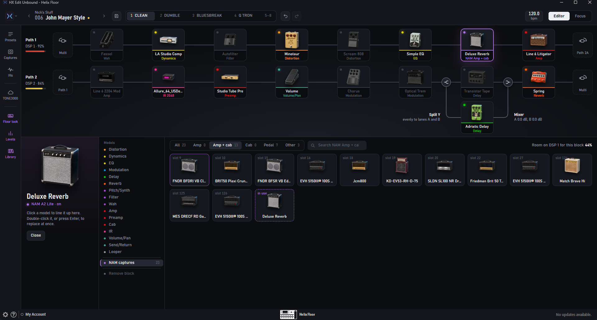
<p align="center"><em>The Workbench on a full preset, picking a NAM capture for a new block.</em></p>

> **A test build.** Windows only. It has run on one Helix Floor with HX Unbound Floor firmware. Not tested: stock Floor firmware, the NAM Pedal firmware, other Helix units. [What has run on a Floor](docs/FLOOR-WORKFLOW.md#status-november-26).

## Get started

You need: Windows 10 or 11 (64-bit), the official **HX Edit 3.82** installed in its usual folder, **Python 3.10 or newer** (64-bit) and **Git**. A Helix Floor with [HX Unbound Floor](https://github.com/Suddl3/hx-unbound-floor) firmware for the NAM features.

```powershell
git clone https://github.com/Suddl3/hx-edit-unbound.git
cd hx-edit-unbound
.\setup.ps1
.\start.ps1
```

`setup.ps1` runs once (about a minute): it checks what you have, fetches the converter, makes the Python environment, offers the sharper gear pictures (about 210 MB) and asks for your TONE3000 key. Run it again any time; it skips what is done. From then on, `.\start.ps1` starts HX Edit Unbound. Close any other HX Edit first.

If Windows says scripts are disabled, run them this way instead: `powershell -ExecutionPolicy Bypass -File .\setup.ps1` (and the same for `start.ps1`).

More: [Setup in detail](docs/FLOOR-SETUP.md), including updating an existing clone and the TONE3000 key.

## Four layouts

Pick one from the menu at the top left; the editor opens in the one you used last.

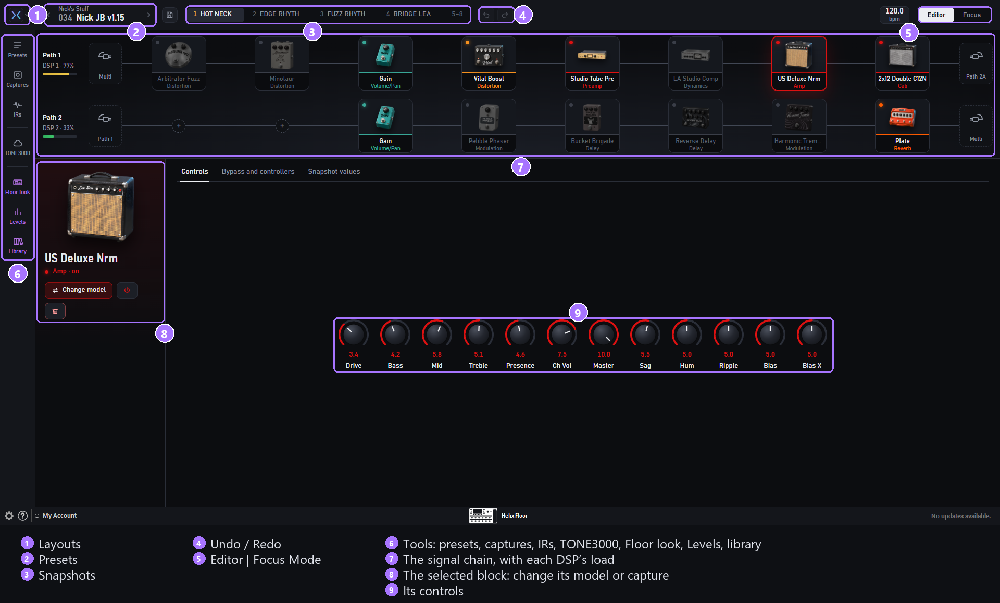
<p align="center"><em>The Workbench, labeled: tools on the left, the chain across the top, the selected block and its controls below.</em></p>

<p align="center">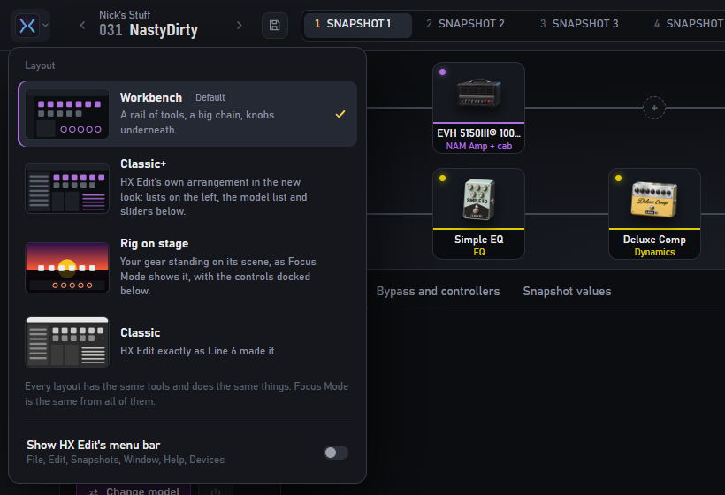</p>
<p align="center"><em>The layout menu, top left: four ways to see the same preset.</em></p>

| | |
|---|---|
| **Workbench** (the default): a rail of tools, the chain large, the selected block's controls underneath. | 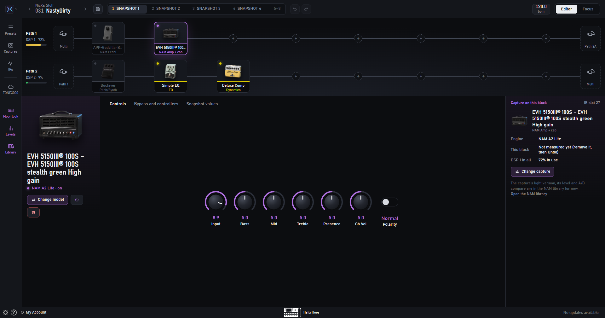 |
| **Classic+**: HX Edit's own arrangement in the new look, with the preset list on the left and the model list beside the controls. | 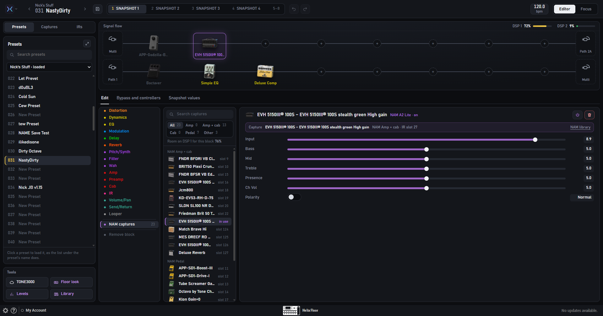 |
| **Rig on stage**: your gear standing in a scene, as Focus Mode shows it, with the controls docked below (here in space). | 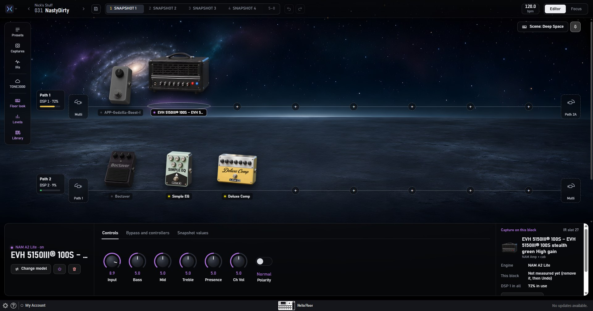 |
| **Classic**: HX Edit exactly as Line 6 made it, with HX Unbound's menu and the TONE3000 button. | 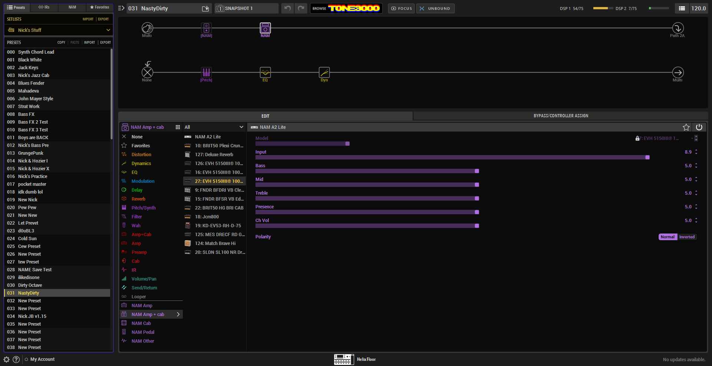 |

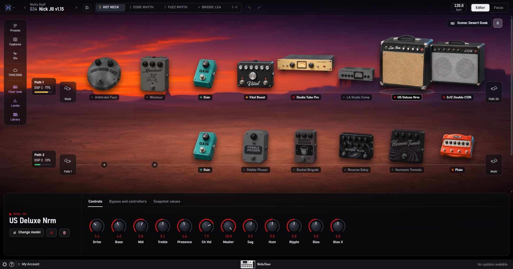
<p align="center"><em>Rig on stage with a full preset, in the Desert Dusk scene.</em></p>

Everything changes the real preset as HX Edit's own controls do, and Undo works the same way.

## What it adds

### Picking models and captures

**Change model** opens one list of every model, with your **NAM captures** as their own category. A click lines a model up on the card ("Replace with …"), a double-click or Enter puts it on the block; after "+", one click adds it. Inputs and outputs have their own chooser.

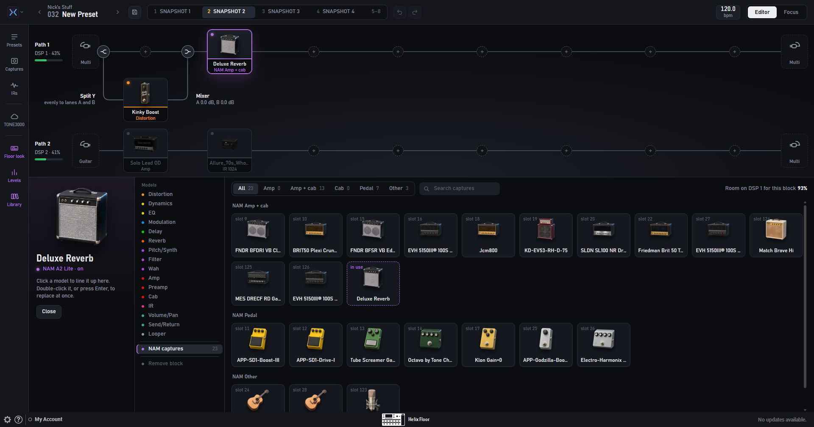
<p align="center"><em>The block picker with your NAM captures as their own category, sorted by kind.</em></p>

### Real gear names

Off by default. In the HX Unbound menu, **Real gear names** shows amps and effects by the gear they model ("A30 Fawn Brt" becomes "Vox AC30 Fawn B"), with the same list HX Unbound Floor firmware can use on the unit (`src/real_names.csv`). It applies the next time you start the editor and changes only the names the editor shows: presets are not touched. Your own `custom-names.csv` (columns `internal`, `real_name`) still wins for the models it lists.

### Your NAM captures, with pictures

The **Library** holds every capture you have, on the Floor or only on this PC: a gear picture for each, sorted into amps, amp + cab, pedals and more, marked guitar or bass. Put one on the Floor, preview it on the selected NAM block, import `.nam` files, or see what is in each of the Floor's 128 slots.

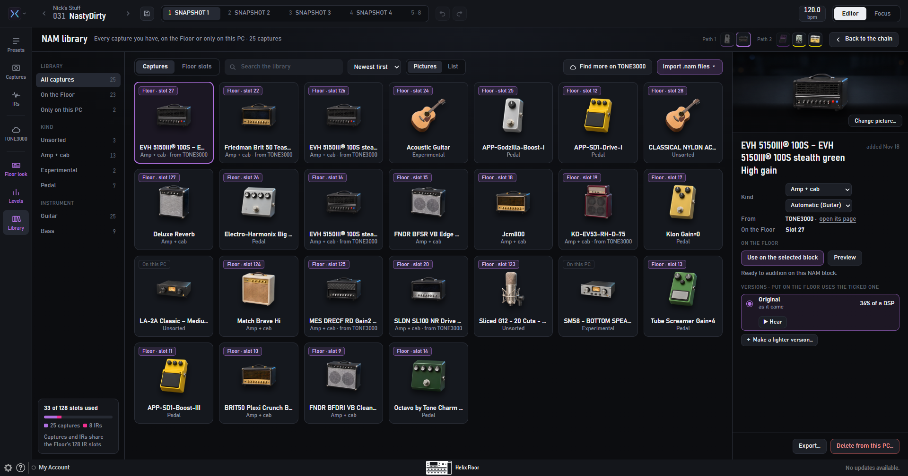
<p align="center"><em>The NAM library: every capture with its gear picture, which slot it is in, and what it is.</em></p>

### TONE3000

Browse [TONE3000](https://www.tone3000.com) inside the editor. Click a tone to hear it on a NAM block of the preset ("Plays on" shows which one; click another to move it), then **Load on Floor** or **Keep on this PC**. Nothing changes for good until you say so: the block gets its own capture back when the preview ends. Pop it out into its own window and keep editing while it plays.

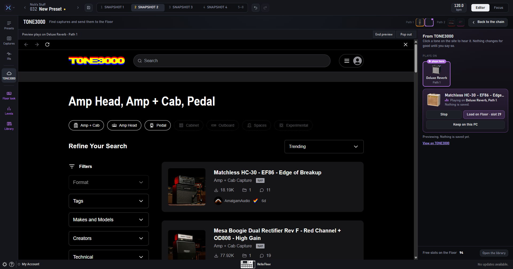
<p align="center"><em>TONE3000 inside the editor: a tone playing on the Deluxe Reverb block, with Load on Floor one click away.</em></p>

A preview borrows **User IR slot 128**: do not keep an IR of your own there.

### Focus Mode

**Focus** shows the selected block large, standing in its scene, with its own knobs and switches; **Editor** goes back. It is modelled on the Floor's own Focus View (savedadodo's work in HX Unbound Floor), and a small frame shows what the Floor draws for the same block. **Floor look** sets the scenes and pictures.

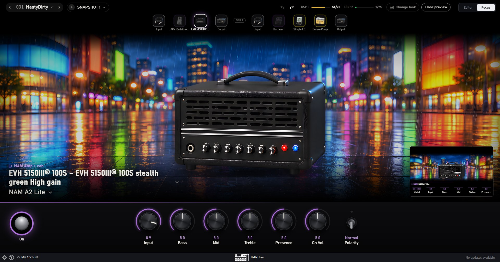
<p align="center"><em>Focus Mode: one block, large, in its scene (here Neon Rain), with its own knobs.</em></p>

### Level presets

**Levels** brings presets and snapshots to one output level. It plays two seconds of your own recorded playing through each snapshot over USB (nothing comes out of your amp), measures them and suggests a change to the output level only. Nothing changes until you Apply, and Undo takes it back.

Levels leaves alone any preset it cannot measure silently or change safely: one whose lane B has an output of its own, or whose output Level is on an expression pedal, MIDI or another controller (Snapshots is fine). Measurements belong to the setlist they were made in, and Cancel stops Apply or Undo before the next preset.

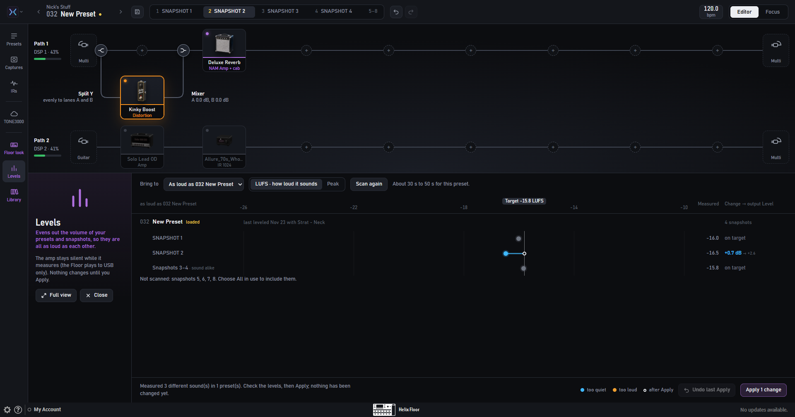
<p align="center"><em>Level presets after a scan: each snapshot measured, with the change it suggests.</em></p>

### And more

The **DSP meter** shows how full each DSP is, as the Floor reports it, and a NAM block is only added where there is room. HX Edit's window is titled **HX Edit Unbound** with its own icon, so it is easy to tell apart from a stock HX Edit. In Classic, some of HX Edit's own controls work a little differently: see [how Classic differs from stock HX Edit](docs/FLOOR-WORKFLOW.md#how-classic-differs-from-stock-hx-edit). The full list is in [what's new](docs/CHANGES.md).

## Firmware

| Needs HX Unbound Floor firmware | Should work on stock firmware (not tested) |
|---|---|
| Anything with a NAM block: the NAM library and its slots, TONE3000 previews and loads, NAM captures in the picker, the capture pictures on the Floor | The four layouts, editing stock blocks, Focus Mode, Level presets, the DSP meter |

On a stock Floor, do not add a NAM block: the stock firmware has none. Your captures, recordings and settings stay on this PC in `%LOCALAPPDATA%\HX Edit NAM`. Nothing here changes the Floor's firmware; for that, see [HX Unbound Floor](https://github.com/Suddl3/hx-unbound-floor).

## Documents

- [Setup in detail](docs/FLOOR-SETUP.md)
- [What's new](docs/CHANGES.md)
- [Workflow and test status](docs/FLOOR-WORKFLOW.md): what each action does and what has run on a Floor.
- [Product vision and roadmap](docs/PRODUCT-VISION.md)
- [Firmware/editor compatibility](https://github.com/Suddl3/hx-unbound-floor/blob/main/EDITOR.md)

## Credits

- **nocaseguy** ([hx-stomp-nam-lite](https://github.com/nocaseguy/hx-stomp-nam-lite)): his work putting Neural Amp Modeler (NAM A2 Lite) into stock Line 6 firmware, so NAM captures run on the HX Stomp, HX Stomp XL and HX Effects' own DSP, is what started HX Unbound and this editor.
- **savedadodo** (HX Unbound Floor): the firmware, the Floor's Focus View that Focus Mode and Rig on stage are modelled on, and the reviews of this editor.
- **Andrei Eronin** ([andreidevs/hx-edit-nam](https://github.com/andreidevs/hx-edit-nam)): HX Edit Unbound began as a fork of his project, which first brought TONE3000 and NAM captures into HX Edit. His commits are kept in this repository's history; his README is preserved in [README_UPSTREAM.md](docs/README_UPSTREAM.md). The converter comes from his [helix-lt-nam](https://github.com/andreidevs/helix-lt-nam).
- [Neural Amp Modeler](https://github.com/sdatkinson/neural-amp-modeler) by Steven Atkinson. Level presets can use NAM's standard reamp file as a test signal when you already have it; it is not distributed here.
- Thanks to the HX Unbound community on Discord for testing and reports, among them Pesketron.

The gear pictures and scenes are **AI-generated**, made for this project.

The TONE3000 name and wordmark belong to TONE3000 and are used only to identify and open their service. HX Edit, Helix and Line 6 are trademarks of Yamaha Guitar Group; this project is not affiliated with them. Stock HX Edit, firmware, personal captures and credentials are not distributed here.
